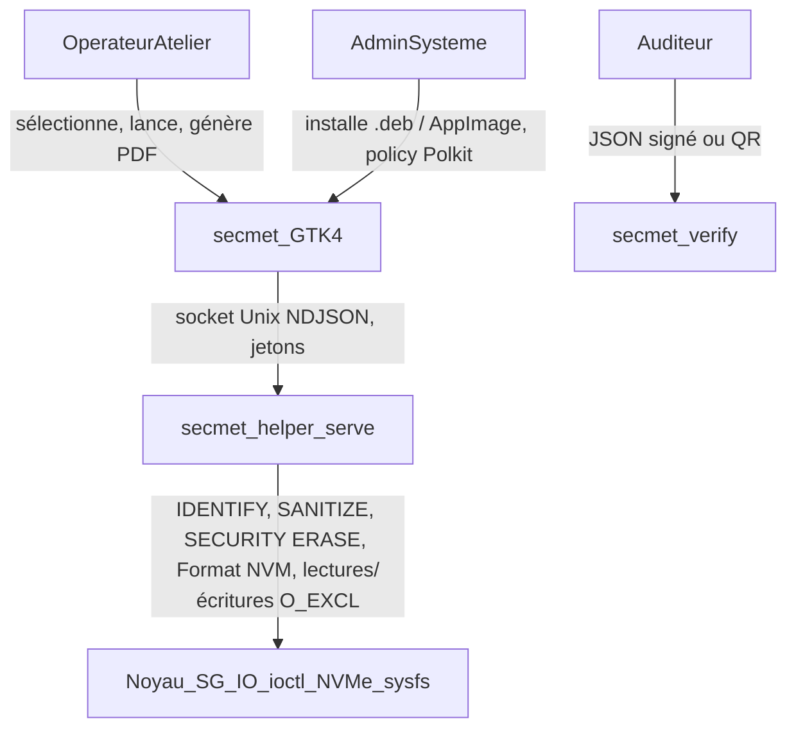
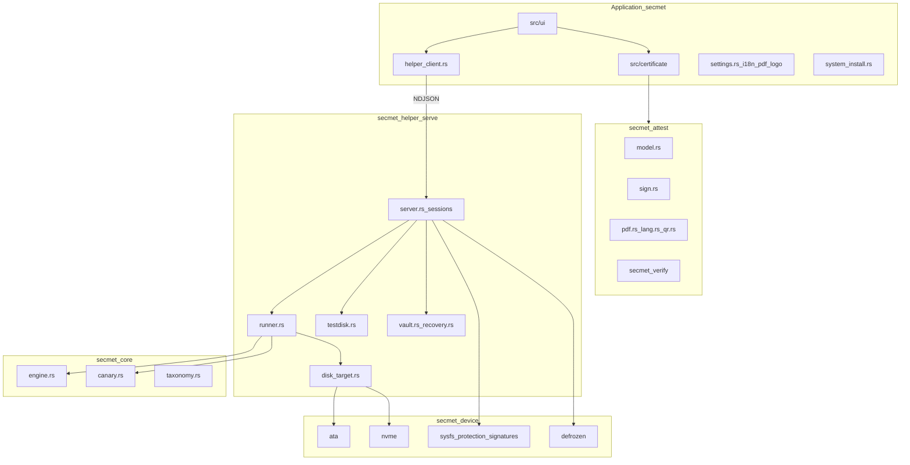
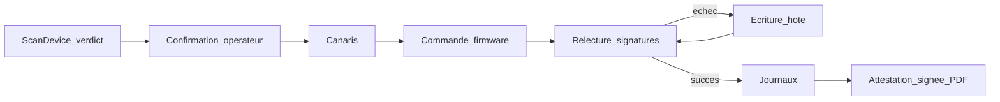

# Annexe F — Spécification technique

> Annexe du Cahier des charges SecMet (document interne) — v0.3.1
>
> **Note** — Ce document décrit l'architecture et le fonctionnement technique du logiciel.  
> Le **cahier des charges** (accord client / développeur sur le produit à livrer) est dans Cahier des charges (document interne, non publié).

| Champ | Valeur |
|-------|--------|
| **Produit** | SecMet |
| **Version logicielle** | 0.3.1 |
| **Identifiant application** | `com.secmet` |
| **Paquet Debian** | `secmet` |
| **Statut du document** | Spécification technique (v2) |
| **Date** | 9 octobre 2026 |
| **Licence** | GPL-3.0-or-later (nom et logo : marque, voir Annexe J) |

---

## 1. Introduction

### 1.1 Contexte

Lors du reconditionnement, du recyclage ou de la mise au rebut de matériel informatique, les données résiduelles sur les disques peuvent rester récupérables après un simple formatage. Les ateliers professionnels ont besoin d'un outil fiable pour **effacer définitivement** le contenu des supports et **documenter** chaque opération, sur le banc lui-même, sans dépendre d'un serveur distant.

**SecMet** répond à ce besoin : application graphique Linux destinée à un **banc d'effacement en atelier**, où l'opérateur branche un ou plusieurs disques, consulte leur identification et leur état, lance l'effacement décidé par le moteur selon les capacités du disque, puis génère un certificat PDF signé.

### 1.2 Objectifs du produit

1. **Effacement irréversible** selon NIST SP 800-88 : commandes firmware (Purge) d'abord, écriture hôte (Clear) en dernier, chaque étape validée par relecture.
2. **Traçabilité** : journaux détaillés, attestation JSON signée par disque, certificat PDF vérifiable hors ligne.
3. **Simplicité d'usage** : flux entièrement graphique, une seule action par session.
4. **Visibilité sur les disques** : identité firmware, capacités, SMART, protections, verdict du moteur, progression.
5. **Autonomie du banc** : aucun outil externe, aucun serveur.
6. **Sécurité opérationnelle** : protection du disque système, confirmations explicites, helper privilégié à surface minimale.

### 1.3 Historique

- v0.1/v0.2 (`shred-graphique` puis SecMet) : orchestration d'outils externes (`shred`, `hdparm`, `nvme-cli`, `smartctl`, `blkid`), certificat HTML rendu par Chromium.
- **v0.3.0** : accès matériel natifs (crate `secmet-device`), moteur de décision NIST (`secmet-core`), daemon privilégié à protocole (`secmet-helper`), attestation signée et PDF natif (`secmet-attest`), AppImage, réglages, interface traduite.

Les journaux de `shred-graphique` sont migrés automatiquement vers `~/.secmet_logs/`.

### 1.4 Public cible

| Profil | Rôle |
|--------|------|
| **Opérateur atelier** | Branche les disques, sélectionne les cibles, lance l'effacement, génère le certificat |
| **Administrateur système** | Installe le `.deb`, le `.rpm` ou l'AppImage, vérifie PolicyKit, choisit la topologie du banc |
| **Intégrateur / auditeur** | Vérifie les attestations signées (`secmet-verify`), consulte les journaux |

### 1.5 Documents connexes

| Document | Rôle |
|----------|------|
| Cahier des charges (document interne, non publié) | Accord sur le produit à livrer |
| [README.md](../../README.md) | Installation et référence technique |
| [Annexe G — Guide utilisateur](Annexe_G_guide_utilisateur.md) | Procédure atelier |
| [Annexe H — Déploiement du banc](Annexe_H_deploiement_banc.md) | Déploiement (dédié, live USB, PXE, AppImage) |
| [Annexe E — Normes](Annexe_E_normes_conformite.md) | Positionnement normatif |
| [Annexe J — Licences](Annexe_J_licences_tierces.md) | Conformité distribution |

---

## 2. Périmètre

### 2.1 Fonctionnalités incluses

- Inventaire des disques par sysfs (transport SATA/SAS/USB/NVMe/virtio, taille, partitions, `rotational`), protections (racine, montages, swap, LVM/RAID/dm tracés par `slaves/`).
- Identification firmware : IDENTIFY DEVICE (ATA, via SG_IO), Identify Controller / Namespace (NVMe), journal sanitize, SMART (attributs ATA avec seuils, page Health NVMe).
- Plan d'effacement par disque (moteur NIST SP 800-88 Rev. 1, politique Rev. 2 disponible) : Purge firmware, replis explicites, dégradation annoncée, écriture hôte en dernier.
- Exécution par le helper : canaris avant commande firmware, sanitize sondé, Format NVM et SECURITY ERASE UNIT bloquants avec progression temporelle, écriture hôte `O_EXCL | O_DIRECT` avec débit et ETA, relecture d'échantillons, recherche de signatures résiduelles.
- Sélection multiple, effacements en parallèle, Stop, relance des échoués.
- Dé-frozen SATA (veille système), déverrouillage ATA avec mot de passe connu, levée automatique des mots de passe posés par SecMet.
- Certificat PDF natif (une page par disque ou lot) rédigé dans la langue de l'interface (fr, en, de), attestation JSON canonique signée Ed25519, QR code, vérificateur `secmet-verify` avec clés de confiance.
- Validation TestDisk optionnelle (lecture seule).
- Réglages : langue (fr, en, de), logo des certificats, nom de l'opérateur par défaut, passes HDD.
- Journalisation sous `~/.secmet_logs/` (0700/0600), migration depuis `shred-graphique`.
- Distribution : paquets `.deb` (Ubuntu 24.04 et 22.04) et `.rpm` (Fedora), AppImage (composant système installé au premier lancement).

### 2.2 Hors périmètre

| Exclusion | Justification |
|-----------|---------------|
| Effacement du disque système (racine `/`) | Protection de la machine atelier |
| Commandes firmware à travers un pont USB | Acquittements non fiables des SATL de ponts ; écriture hôte (Clear) uniquement |
| Contournement d'un verrou ATA Security sans mot de passe | Jamais tenté : mot de passe du propriétaire ou destruction physique |
| Annulation d'un Format NVM ou d'un SECURITY ERASE UNIT lancé | Commandes bloquantes dans le pilote |
| Gestion centralisée multi-postes, effacement distant | Application locale |
| Images live USB ou infrastructure PXE clé en main | Le client provisionne son banc ([Annexe H](Annexe_H_deploiement_banc.md)) |

### 2.3 Topologies de banc

| Topologie | Rôle du réseau | Cas d'usage | Livrable |
|-----------|----------------|-------------|----------|
| **Machine dédiée** | Optionnel | Atelier fixe, référence | `.deb` |
| **Live USB** | Non requis | Effacement sur place (laptop) | AppImage sur la clé |
| **PXE** | Boot initial | Parc homogène | AppImage ou `.deb` dans l'image |

---

## 3. Acteurs et cas d'usage



| ID | Intitulé | Préconditions | Résultat attendu |
|----|----------|---------------|------------------|
| **UC-01** | Démarrer une session | Application installée, `pkexec` setuid | Helper lancé après un mot de passe, inventaire affiché sans bloquer la fenêtre |
| **UC-02** | Rafraîchir les disques | Session active | Inventaire relu, scans relancés ; refusé pendant un effacement |
| **UC-03** | Effacer un ou plusieurs disques | Verdict `ready`, disques non protégés | Plan exécuté, statut, validation et rapport par disque |
| **UC-04** | Dé-geler un disque SATA | Disque FROZEN, aucun job en cours | Veille, ré-identification, FROZEN levé |
| **UC-05** | Déverrouiller un disque ATA | Mot de passe connu | SECURITY UNLOCK puis DISABLE PASSWORD |
| **UC-06** | Arrêter un effacement | Écriture hôte ou sanitize en cours | Arrêt entre deux blocs ou deux sondages ; firmware bloquant non interrompu |
| **UC-07** | Consulter l'état d'un disque | Scan effectué | Identité, capacités, SMART, verdict |
| **UC-08** | Générer le certificat | Tous les jobs terminés | PDF et attestations signées sous `~/.secmet_logs/certificates/` |
| **UC-09** | Vérifier un certificat | JSON ou QR, clé de confiance | `secmet-verify` : signature et confiance de la clé |
| **UC-10** | Valider par TestDisk | Au moins un succès | Verdict dans le dialogue, journal archivé |
| **UC-11** | Régler langue, logo et opérateur | Aucune opération en cours | Fenêtre reconstruite ; PDF suivants rédigés dans la langue choisie, avec le logo choisi ; nom de l'opérateur pré-rempli |
| **UC-12** | Installer le composant (AppImage) | Composant absent ou différent | Helper, policy et TestDisk installés par pkexec |

---

## 4. Exigences fonctionnelles

### 4.1 Inventaire et identification

| ID | Exigence | Critère de validation |
|----|----------|----------------------|
| **EF-01** | Lister les disques physiques depuis `/sys/block` (exclure loop, ram, dm, md) avec transport, taille, partitions | Seuls les disques entiers apparaissent, transport correct |
| **EF-02** | Rattacher à chaque disque ses protections : hôte de la racine, montages, swap, membre de volume (via `slaves/`) | Disque protégé INDISPONIBLE avec motif ; `root_traced` faux signalé par un bandeau |
| **EF-03** | Identifier par firmware : IDENTIFY DEVICE (ATA) ou Identify Controller/Namespace (NVMe), SMART, journal sanitize | Modèle, série, firmware, capacités et état ATA Security exacts |
| **EF-04** | Classer le média (HDD/SSD) par le mot 217 d'IDENTIFY, repli sur `rotational` sysfs | Un HDD ancien sans mot 217 reste HDD |
| **EF-05** | Ne jamais envoyer de commande firmware à travers un pont USB | Transport USB : écriture hôte seulement |

### 4.2 Décision et exécution

| ID | Exigence | Critère de validation |
|----|----------|----------------------|
| **EF-06** | Refuser le disque hébergeant `/`, les disques montés, le swap, les membres de volumes, les médias en lecture seule | Verdict `refused` avec motifs ; helper refuse `ExecutePlan` |
| **EF-07** | Produire un plan : primaire, replis ordonnés, méthodes écartées avec consigne, dégradation, recommandations de destruction (SMART) | Plan visible dans le dialogue de confirmation et dans le certificat |
| **EF-08** | Poser des canaris (ChaCha20, seed de session) sur un échantillon avant toute commande firmware et vérifier leur disparition | Un firmware qui acquitte sans effacer fait échouer l'étape |
| **EF-09** | Exécuter les plans en parallèle, un job par disque, ouverture `O_EXCL | O_DIRECT` et ré-identification avant écriture | Deux disques effacés simultanément ; nœud recréé entre-temps refusé |
| **EF-10** | Publier la progression : étape, phase, pourcentage, octets, débit, ETA, annulable | Barre et texte mis à jour ; Stop grisé pendant une commande non annulable |
| **EF-11** | Annuler entre deux blocs ou deux sondages ; ne jamais interrompre une relecture après succès firmware | Statut ARRÊTÉ ; relecture complète |
| **EF-12** | Dé-frozen par veille système, refusé pendant un job | FROZEN levé après reprise |
| **EF-13** | Valider chaque étape : relecture d'échantillons (canaris, motif attendu, zéros), signatures résiduelles en tête et queue | Verdict de validation dans journaux et certificat |
| **EF-14** | SECURITY ERASE UNIT : mot de passe aléatoire enregistré dans le coffre avant SET PASSWORD, levé après ; levée automatique au scan suivant si interrompu | Disque jamais laissé verrouillé par SecMet ; refus consigné, entrée mise de côté |

### 4.3 Traçabilité et certificat

| ID | Exigence | Critère de validation |
|----|----------|----------------------|
| **EF-15** | Journaliser chaque session sous `~/.secmet_logs/sessions/<ID>/` (0700/0600) | `journal.log` et `<disque>.log` créés, en français |
| **EF-16** | Produire un rapport JSON de session | `session_report_<date>.json` |
| **EF-17** | Générer un certificat PDF natif (PDF 1.4, polices standard, encodage WinAnsi, JPEG du logo) dans la langue de l'interface | Une page par disque ou tableau de lot ; libellés fr, en ou de sans troncature |
| **EF-18** | Signer chaque attestation (JSON canonique, Ed25519) et l'incorporer en QR (Base45, version ≤ 24) | `secmet-verify` valide le JSON et le QR |
| **EF-19** | Porter la catégorie NIST réellement obtenue et les réserves (USB, dégradation, série absente, hôte non identifié, espaces de noms NVMe non couverts) | Catégorie « non classé » sans relecture ou en cas d'échec |
| **EF-20** | Inclure l'identité du banc (DMI via sysfs) | Fabricant, modèle, série |
| **EF-21** | Activer « Générer le PDF » uniquement quand tous les jobs sont terminés | Bouton grisé pendant les effacements |

### 4.4 Réglages, identité, migration

| ID | Exigence | Critère de validation |
|----|----------|----------------------|
| **EF-22** | Migrer `~/.shred_graphique_logs/` vers `~/.secmet_logs/` | Données accessibles après premier lancement |
| **EF-23** | Interface traduite fr/en/de ; certificats PDF et textes libres de l'attestation dans la langue de l'interface au moment de la génération ; journaux en français | Changement immédiat, verrouillé pendant une opération ; tests de complétude des traductions et de largeur des libellés du PDF |
| **EF-24** | Logo des certificats configurable (conversion JPEG, bornes 8192 px / 128 Mio) | Logo visible en en-tête des PDF suivants |
| **EF-25** | Logo SecMet dans l'interface et par défaut sur le PDF ; icône dédiée au lanceur | Visible dans les deux livrables |
| **EF-26** | Nom de l'opérateur par défaut enregistré dans les réglages | Pré-rempli dans le dialogue « Générer le PDF », modifiable à chaque génération |
| **EF-27** | Vérifier le canal de publication (`latest.json` signé par une clé de version intégrée) au démarrage et toutes les 24 h, hors ligne non bloquant, désactivable | Point jaune sur Réglages et section Mises à jour si une version plus récente est annoncée ; annonce non signée ou clé inconnue ignorée |

---

## 5. Exigences non fonctionnelles

| ID | Catégorie | Exigence |
|----|-----------|----------|
| **ENF-01** | Sécurité | Élévation via PolicyKit uniquement (`com.secmet.pkexec.helper`, `auth_admin_keep`) ; pas de repli `sudo` |
| **ENF-02** | Sécurité | Helper : socket `/run/secmet/helper.sock` (0700), jeton de démarrage, jetons par disque liés au devnum, au numéro de série et à l'empreinte firmware, 10 min de validité, 32 connexions, délais de lecture/écriture, options CLI refusées sous pkexec, arrêt automatique après 10 min d'inactivité |
| **ENF-03** | Sécurité | Ouverture des disques `O_EXCL | O_DIRECT | O_NOFOLLOW`, cohérence devnum sysfs / nœud ouvert, aucune commande firmware sur un disque tenu par un job |
| **ENF-04** | Sécurité | Aucun `unwrap`/`expect` en production, `unsafe` confiné à `secmet-device::sys` et `aligned`, `panic = abort` |
| **ENF-05** | Traçabilité | Attestations signées Ed25519, clé privée 0600, vérificateur n'acceptant que des clés de confiance |
| **ENF-06** | Portabilité | Debian/Ubuntu/Mint amd64 (paquets Ubuntu 24.04 et 22.04), Fedora (`.rpm`), GTK 4 ; AppImage assemblée dans Ubuntu 24.04 (glibc ≥ 2.39) |
| **ENF-07** | Performance | Écriture hôte par blocs de 4 Mio alignés, débit affiché ; release LTO |
| **ENF-08** | Robustesse | Délais sur chaque commande firmware (30 s IDENTIFY, durée annoncée pour SECURITY ERASE), fil GTK jamais bloqué par une invite Polkit |
| **ENF-09** | Robustesse | Décodage borné des réponses (sense, journaux NVMe, TestDisk), listes et chaînes du PDF tronquées |
| **ENF-10** | Maintenabilité | Cinq crates, 249 tests unitaires, clippy strict, `cargo fmt`, intégration continue GitHub Actions (tests, audit, fuzzing de neuf décodeurs, paquets) |
| **ENF-11** | Accessibilité | Interface et certificats en français, anglais, allemand ; avertissements explicites |
| **ENF-12** | Autonomie | Aucun outil externe hors TestDisk (optionnel, embarqué) |

---

## 6. Architecture technique

### 6.1 Stack technologique

| Couche | Technologie |
|--------|-------------|
| Langage | Rust 2021 (rust-version 1.80) |
| Interface graphique | GTK 4 (`gtk4` 0.9, `glib` 0.20) |
| Accès matériel | `libc` (ioctl `SG_IO`, `NVME_IOCTL_ADMIN_CMD`), sysfs |
| Cryptographie | `chacha20` (canaris), `sha2`, `ed25519-dalek`, `zeroize` |
| Certificat | Rendu PDF 1.4 maison, `qrcode`, Base45 maison, `flate2` (zlib) |
| Sérialisation | serde / serde_json |
| Images (logo) | `image` 0.25 |
| Réseau (mises à jour) | `ureq` 2 + `rustls` (HTTPS, racines embarquées) |
| Privilèges | PolicyKit + `pkexec` |
| Packaging | Debian `.deb`, Fedora `.rpm`, AppImage (linuxdeploy dans un conteneur Ubuntu 24.04) |
| Intégration continue | GitHub Actions : `ci.yml` (fmt, clippy, tests, `cargo audit`, shellcheck), `fuzz.yml` (cargo-fuzz), `package.yml` (paquets installés et testés en conteneur) |

### 6.2 Diagramme des composants



### 6.3 Binaires et fichiers

| Binaire | Rôle | Emplacement |
|---------|------|-------------|
| `secmet` | Application graphique | `/usr/bin/secmet` |
| `secmet-helper` | Daemon privilégié (`serve`) | `/usr/bin/secmet-helper` |
| `secmet-verify` | Vérification d'attestations | `/usr/bin/secmet-verify` |
| `testdisk` embarqué | Validation optionnelle | `/usr/lib/secmet/bin/testdisk`, bibliothèques sous `/usr/lib/secmet/lib/` |
| Policy | PolicyKit | `/usr/share/polkit-1/actions/secmet.policy` |

### 6.4 Protocole du helper

Le helper est lancé par `pkexec /usr/bin/secmet-helper serve`, imprime `{"socket","bootstrap","ttl_seconds"}` sur stdout, puis sert `/run/secmet/helper.sock` en NDJSON (`{"id","cmd":{...}}` → `{"id","ok"|"error"|"event"}`).

| Commande | Rôle |
|----------|------|
| `Authenticate` | Jeton de démarrage → session |
| `ListDisks`, `HostInfo` | Inventaire sysfs avec protections et `root_traced` ; DMI du banc |
| `ScanDevice` | Identification firmware, capacités, verdict du moteur, jeton de disque ; levée automatique d'un mot de passe SecMet |
| `PrepareCanaries` | Pose des canaris de session |
| `ExecutePlan` | Confirmation (numéro de série ou empreinte), ouverture `O_EXCL`, exécution du plan ; flux d'événements `StepStarted`, `Progress`, `Log`, `StepFinished`, rapport final |
| `Cancel`, `GetStatus` | Annulation coopérative, état d'un job |
| `Unfreeze` | Veille système puis ré-identification (refusé si un job tourne) |
| `Unlock` | SECURITY UNLOCK + DISABLE PASSWORD avec mot de passe fourni |
| `VerifyTestdisk` | TestDisk en lecture seule |
| `Shutdown` | Arrêt, différé tant qu'un job ou une analyse tourne |

Chaque jeton de disque encode `major:minor`, numéro de série et empreinte (SHA-256 du modèle, de la série, du firmware, du WWN et de la taille) ; toute divergence à l'ouverture est une erreur d'identité.

### 6.5 Moteur de décision (`secmet-core`)

Entrée : capacités de la cible (média, transport, ATA/NVMe, santé, protections, échec d'inspection), politique, préférences. Sortie :

- `Refused { reasons }` : protections ou média en lecture seule ;
- `Blocked { reasons, guidance }` : verrouillé, tentatives expirées, sanitize en cours ou en échec ;
- `Ready(plan)` : primaire, replis, exclus (gelé, mot de passe tiers, pont USB, repli hôte interdit), dégradation, recommandations de destruction, notes (espaces de noms NVMe non couverts), santé du support à la décision.

**Verdict final** (`secmet-core::disposition`) : à partir du plan et des traces d'exécution (méthode et issue de chaque étape), une fonction pure conclut sur le **sort du support** — `reusable`, `destroy_recommended`, `destroy_required` ou `retry` — avec ses raisons (codes stables : `SmartFailing`, `UnreadableSectors`, `WritesNotPersisted`, `FirmwareIneffective`, `ReadOnlyMedia`, `LockedWithoutPassword`, `ReallocatedNotOverwritten`, `Cancelled`, `IoError`, `FirmwareFailure`, `NoMethod`, `Blocked`, `Protected`) et les consignes avant relance. Un échec avec preuve matérielle (secteurs illisibles, écritures non persistantes, firmware sans effet sans repli abouti) ou sur un disque déjà condamné par le SMART est terminal : l'interface n'offre plus « Relancer », le badge passe à **À DÉTRUIRE**. Le helper porte le verdict dans le rapport de job (`disposition`, `disposition_reasons`, `disposition_guidance`) ; l'interface le reporte dans l'attestation signée et le PDF.

Ordre des candidats : NVMe Sanitize (block, crypto), Format NVM (crypto, user data), Sanitize overwrite ; ATA SANITIZE (crypto scramble, block erase, overwrite HDD), SECURITY ERASE (enhanced, normal) ; écriture hôte. Chaque étape porte ses critères d'échec et sa spécification de relecture.

| Méthode | Niveau (Rev. 1) |
|---------|-----------------|
| NVMe / ATA SANITIZE | Purge |
| Format NVM crypto / user data | Purge |
| SECURITY ERASE enhanced (SSD), normal ou enhanced (HDD) | Purge |
| SECURITY ERASE normal (SSD) | Clear |
| Écriture hôte | Clear, jamais Purge |

### 6.6 Flux d'effacement



Les commandes bloquantes (Format NVM, SECURITY ERASE UNIT) tournent sur un fil dédié avec une progression temporelle issue de la durée annoncée par le disque ; le sanitize est sondé toutes les 2 s ; l'écriture hôte publie octets, débit et ETA.

---

## 7. Interface utilisateur

### 7.1 Principes

Mono-fenêtre, flux atelier (détecter → sélectionner → effacer → certifier), avertissement permanent, retour visuel par carte, actions destructives confirmées, fil GTK jamais bloqué (chargements et invites sur fils dédiés), trois langues.

### 7.2 Zones

| Zone | Contenu |
|------|---------|
| Barre de titre | Titre, icône Réglages |
| Bandeaux | Avertissement d'irréversibilité ; avis « disque système non identifié » si nécessaire |
| Sélection | « Tout sélectionner », total |
| Cartes | Case, nom, bouton i, badge d'état, sous-titre, progression, Stop, vérification, Détails |
| Actions | Rafraîchir, TestDisk, Générer le PDF, Relancer les échoués, Déverrouiller, Dé-frozen, Lancer la suppression sécurisée |

### 7.3 États d'une carte

`inactif` → `en cours` → `terminé` / `arrêté` / `échec` ; `indisponible` (protection), `bloqué` (verrou, sanitize). La vérification affiche OK / KO / non effectuée.

### 7.4 Identité visuelle

| Support | Asset |
|---------|-------|
| Application | `content/SecMet_logo.svg` (variante blanche) |
| Certificat | `resources/secmet_logo.jpg` (défaut) ou logo personnalisé |
| Lanceur | `content/SecMet_icon.svg` |

---

## 8. Modèle de données

### 8.1 Arborescence

```
~/.secmet_logs/
├── sessions/<SEC-AAAAMMJJ-XXXX>/
│   ├── journal.log                 # synthèse de session (fr)
│   ├── <disque>.log                # rapport d'étapes, validation, TestDisk
├── session_report_<date>.json      # rapport structuré
└── certificates/
    ├── <SEC-…>.pdf                 # une page par disque
    ├── <SEC-…>-<disque>.json       # attestation signée
    ├── <SEC-…>-lot.pdf / -lot.json # format groupé
~/.config/secmet/                   # ou SECMET_DATA_DIR/config (clé live) ; ~/.secmet_logs devient SECMET_DATA_DIR/logs
├── settings.json                   # hdd_passes, language, pdf_logo, operator_name, check_updates, update_url
├── update-state.json               # dernière vérification des mises à jour, dernier latest.json valide
├── pdf-logo.jpg
├── attestation-key.hex (0600)      # graine Ed25519
├── attestation-key.pub
└── trusted-keys                    # clés acceptées par secmet-verify
/var/lib/secmet/ata-security/       # coffre des mots de passe SecMet (root) ; SECMET-DATA/vault/ si la clé est montée (annexe M)
```

### 8.2 Attestation signée

```json
{
  "alg": "Ed25519", "key_id": "…", "public_key": "…",
  "payload": {
    "version": 1, "certificate_id": "SEC-…-sdc", "session_id": "SEC-…",
    "issued_at": "…", "operator": "…", "software": "secmet 0.3.1",
    "disk": {"name","model","serial","firmware","media","transport","capacity","size_bytes"},
    "erasure": {"method_code","method_label","nist_level","policy","outcome","started_at","finished_at","duration_seconds","caveats","disposition","disposition_reasons"},
    "validation": {"kind","seed","samples","anomalies","evidence_sha256","residual_signatures","verify_status"},
    "bench": {"manufacturer","model","serial"},
    "report_sha256": "…"
  },
  "signature": "…"
}
```

La signature couvre la forme canonique du `payload`. Les listes (réserves, signatures) sont bornées à 8 éléments de 160 caractères avant signature pour que le QR reste lisible.

Les textes libres (`method_label`, `caveats`, `verify_status`, mentions « non disponible » / « inconnu ») sont rédigés dans la langue du PDF ; les champs vérifiables (`method_code`, `nist_level`, `outcome`, `evidence_sha256`, `seed`) n'en dépendent pas. Les libellés fixes du PDF viennent de `secmet-attest::lang`, les textes libres des tables `src/i18n/certificate.rs`.

### 8.3 Structures principales

| Structure | Crate / module | Rôle |
|-----------|----------------|------|
| `DiskEntry`, `ProtectionReport` | `secmet-device::sysfs`, `protection` | Inventaire et protections |
| `IdentifyDevice`, `IdentifyController`, `SanitizeStatus` | `secmet-device::ata`, `nvme` | Identité et capacités firmware |
| `TargetCapabilities`, `ErasePlan`, `PlannedStep` | `secmet-core::taxonomy`, `engine` | Entrée et sortie du moteur |
| `JobReport`, `StepReport`, `ValidationSummary` | `secmet-helper::runner` | Résultat d'exécution |
| `Disk`, `SessionReport`, `DiskOperationRecord`, `JobOutcomeRecord` | `secmet` | Modèle de l'interface et de la session |
| `Attestation`, `SignedAttestation` | `secmet-attest::model`, `sign` | Certificat |

---

## 9. Sécurité et privilèges

1. **Au lancement** : `pkexec secmet-helper serve` (un mot de passe) ; `auth_admin_keep` pour la session ; refus de démarrage sans `pkexec` setuid.
2. **Helper** : un seul client authentifié par jeton de démarrage ; jetons de disque à durée limitée ; refus de toute commande firmware sur un disque tenu par un job, quelle que soit la session ; refus du dé-frozen pendant un job ; arrêt différé ; options de test refusées sous pkexec ; répertoire du socket vérifié et jamais re-chmodé.
3. **Disques** : ouverture `O_EXCL | O_DIRECT | O_NOFOLLOW`, cohérence devnum, ré-identification, protections relues à l'ouverture, disque système refusé par l'interface et par le helper.
4. **Mots de passe ATA** : générés aléatoirement, conservés dans un coffre root le temps de l'effacement, levés ensuite ; jamais de contournement ; le mot de passe saisi pour `Unlock` est effacé de la mémoire après usage.
5. **Certificats** : clé de signature privée 0600, journaux et certificats 0700/0600, vérificateur strict sur la confiance des clés.
6. **AppImage** : installeur embarqué dans le binaire, extraction depuis le fichier AppImage par root (le montage FUSE est inaccessible à root), refus des liens symboliques, fichiers installés en root 0755/0644.

### 9.1 Limitations assumées

- **USB** : écriture hôte uniquement, catégorie Clear.
- **Frozen** : intervention requise (veille, hot-plug).
- **Commandes bloquantes** non interruptibles.
- **Racine non tracée** (média live, ZFS) : protection du disque système par verrou exclusif uniquement, signalée.
- **NVMe multi-espaces de noms** : seul l'espace ouvert est couvert par Format NVM sans FNA bit 1 ou par écriture hôte ; signalé dans le plan et le certificat.
- **Identification** : une confusion entre deux disques non protégés reste un risque opérationnel, mitigé par l'affichage de la série et la confirmation.

---

## 10. Déploiement et maintenance

### 10.1 Construction

```bash
make build      # target/release/{secmet,secmet-helper,secmet-verify}
make deb        # dist/secmet_0.3.1_amd64.deb
make rpm        # dist/secmet-0.3.1-1.<distribution>.x86_64.rpm (Fedora)
make appimage   # dist/SecMet_0.3.1_x86_64.AppImage (conteneur Ubuntu 24.04)
make release    # dist/release/0.3.1/ : paquets fumés en conteneurs, SHA256SUMS(.sig), latest.json signés (Annexe N)
```

### 10.2 Dépendances du paquet `.deb`

| Type | Paquets |
|------|---------|
| **Depends** | `libgtk-4-1`, `policykit-1` |
| **Recommends** | `testdisk`, `evince` \| `atril` \| `okular` |
| **Replaces / Conflicts** | `shred-graphique` |

### 10.3 Fichiers installés

| Chemin | Contenu |
|--------|---------|
| `/usr/bin/secmet`, `/usr/bin/secmet-helper`, `/usr/bin/secmet-verify` | Binaires |
| `/usr/share/applications/secmet.desktop`, `/usr/share/icons/hicolor/scalable/apps/secmet.svg` | Lanceur |
| `/usr/share/polkit-1/actions/secmet.policy` | PolicyKit |
| `/usr/lib/secmet/bin/testdisk`, `/usr/lib/secmet/lib/` | TestDisk embarqué |
| `/usr/share/doc/secmet/` | Licences, guide utilisateur, guide de déploiement, annexes, conformité |

### 10.4 Développement

```bash
make deps ; make dev ; make run ; make test ; make verify-polkit
cargo clippy --workspace --all-targets -- -D warnings ; cargo fmt --all
```

### 10.5 Évolutions envisageables

- Format NVM par NSID de diffusion sur contrôleurs multi-espaces de noms (après validation matérielle).
- Codes stables pour tous les messages du helper (traduction intégrale des détails d'erreur).
- Épinglage et empreinte des outils linuxdeploy téléchargés par la construction de l'AppImage.
- Supervision centralisée (hors périmètre actuel).
- Clé USB SecMet et lots persistants sur plusieurs machines : spécifiés dans l'[Annexe M](Annexe_M_cle_live_lots.md).
- Mises à jour signées et chaîne de publication `make release` : spécifiées dans l'[Annexe N](Annexe_N_mises_a_jour.md).

---

## Annexe A — Correspondance exigences / modules

| Exigence | Modules |
|----------|---------|
| EF-01 à EF-05 | `secmet-device::sysfs`, `protection`, `ata::identify`, `nvme::decode` ; `secmet-helper::identity` |
| EF-06 à EF-14 | `secmet-core::engine`, `canary` ; `secmet-helper::server`, `runner`, `disk_target`, `vault`, `recovery` ; `src/ui/erase.rs` |
| EF-15 à EF-21 | `src/certificate/`, `src/trace_log.rs`, `secmet-attest` (dont `lang`) |
| EF-22 à EF-26 | `src/migrate.rs`, `src/i18n/`, `src/settings.rs`, `src/pdf_logo.rs`, `src/logo.rs`, `src/ui/settings_ui.rs`, `src/ui/pdf_ui.rs` |
| EF-27 | `src/update.rs`, `src/ui/update_ui.rs`, `secmet-attest::release` |
| ENF-01 à ENF-03 | `src/pkexec_gate.rs`, `secmet-helper::polkit`, `session`, `isolation`, `secmet.policy` |

## Annexe B — Glossaire technique

| Terme | Définition |
|-------|------------|
| **Canari** | Motif unique par bloc écrit avant une commande firmware ; sa survie prouve un effacement non effectué |
| **Plan** | Suite ordonnée d'étapes (méthode, niveau, critères d'échec, relecture) décidée par le moteur |
| **Jeton de disque** | Autorisation à durée limitée délivrée par le helper pour un disque identifié |
| **SATL** | Couche de traduction SCSI/ATA (libata, pont USB, HBA SAS) ; conditionne le CDB ATA PASS-THROUGH utilisé |
| **Frozen** | SECURITY FREEZE LOCK posé par le BIOS : commandes Security et parfois Sanitize refusées |
| **Attestation** | Charge utile du certificat, JSON canonique signé Ed25519 |

---

*Document rédigé à partir de l'état du dépôt SecMet v0.3.1 (octobre 2026).*
